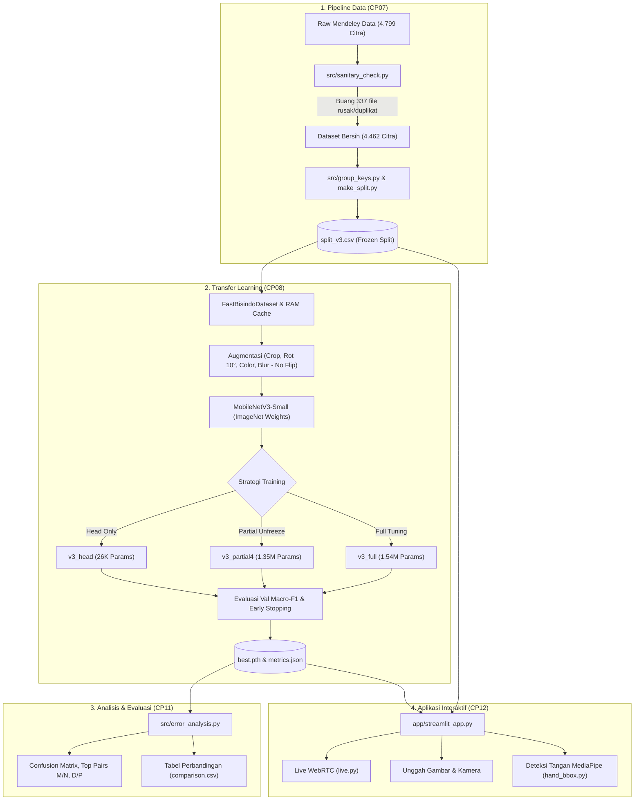

# DOKUMENTASI LENGKAP PROYEK AKHIR VISI KOMPUTER
**Pengenalan Alfabet BISINDO (A–Z) Menggunakan Transfer Learning MobileNetV3-Small dan Antarmuka Streamlit**

- **Mata Kuliah:** Visi Komputer (IF0PP006)
- **Kelas:** 5PITA — Semester Ganjil 2026/2027
- **Kelompok:** 4
- **Aplikasi Antarmuka Utama:** `app/streamlit_app.py`
- **Repositori:** `Bisindo-cv`

---

## DAFTAR ISI
1. [Manajemen Tim, Peran, dan Tata Kelola](#1-manajemen-tim-peran-dan-tata-kelola)
2. [Matriks Perencanaan Proyek](#2-matriks-perencanaan-proyek)
3. [Problem Statement, Konteks Pengguna, dan 5 Rujukan Akademik](#3-problem-statement-konteks-pengguna-dan-5-rujukan-akademik)
4. [Dataset, Lisensi, Statistik, Bias, Leakage, dan Strategi Split](#4-dataset-lisensi-statistik-bias-leakage-dan-strategi-split)
5. [Baseline, Metrik Evaluasi, dan Target Keberhasilan](#5-baseline-metrik-evaluasi-dan-target-keberhasilan)
6. [Diagram Pipeline, Konfigurasi Inti, dan Kontrol Eksperimen](#6-diagram-pipeline-konfigurasi-inti-dan-kontrol-eksperimen)
7. [Struktur Repositori dan Pemilahan File (Digunakan vs Tidak Digunakan)](#7-struktur-repositori-dan-pemilahan-file-digunakan-vs-tidak-digunakan)
8. [Verifikasi Data, Sanity Check, dan Loader Determinisme](#8-verifikasi-data-sanity-check-dan-loader-determinisme)
9. [Catatan Pelatihan, Logging, dan Waktu Inferensi Awal](#9-catatan-pelatihan-logging-dan-waktu-inferensi-awal)
10. [Tabel Hasil Eksperimen pada Split Beku](#10-tabel-hasil-eksperimen-pada-split-beku)
11. [Analisis Kegagalan (Failure Analysis) dan Perbaikan Teruji](#11-analisis-kegagalan-failure-analysis-dan-perbaikan-teruji)
12. [Aplikasi Antarmuka Streamlit, Latensi/FPS, dan Fallback Demo](#12-aplikasi-antarmuka-streamlit-latensifps-dan-fallback-demo)
13. [Rencana Presentasi UAS, Pembagian Peran, dan Video Cadangan](#13-rencana-presentasi-uas-pembagian-peran-dan-video-cadangan)
14. [Checklist Kesiapan Pengumpulan Final](#14-checklist-kesiapan-pengumpulan-final)

---

## 1. Manajemen Tim, Peran, dan Tata Kelola

### A. Anggota Tim & Akun GitHub
| No | Nama / Identitas | Akun GitHub | Peran Utama Proyek | Tanggung Jawab Deliverable |
|:---:|---|---|---|---|
| 1 | **Anggota 1** | `@loeychanpy` | **Project Lead & Integrator** | Tata kelola repo, `configs/config.yaml`, integrasi PR/merge, dan penyusunan README master. |
| 2 | **Anggota 2** | `@NoluckDv` | **Data & Leakage Engineer** | Pembuatan `src/make_split.py`, audit kebocoran data, pemetaan `label_map.json`, dan formulasi `split_v3.csv`. |
| 3 | **Anggota 3** | `@Vetians` | **Data Pipeline & Sanity Lead** | Pembuatan `src/sanitary_check.py`, pembersihan citra korup/duplikat, `src/dataset.py`, dan pipeline augmentasi. |
| 4 | **Anggota 4** | `@Pongo` *(User)* | **Model & Application Engineer** | Transfer learning `src/train_transfer.py`, benchmarking `head/partial/full`, inferensi `demo.py`, dan arsitektur GUI `app/streamlit_app.py`. |

### B. Kanal Komunikasi
- **Komunikasi Harian & Koordinasi Instan:** Grup WhatsApp Kelompok 4 (respon cepat kendala teknis).
- **Rapat Daring & Screen-Sharing:** Discord Server Kelompok 4 (voice channel khusus untuk sesi *pair-programming* dan latihan presentasi).
- **Manajemen Kode & Isu:** GitHub Issues & Pull Requests pada branch terpisah (`feat/model`, `feat/optimize`).

### C. Aturan Rapat
- **Jadwal Tetap:** Rapat mingguan diadakan setiap hari Selasa pukul 19.30 WIB setelah jadwal kuliah/asistensi laboratorium.
- **Format Pertemuan:** Sesi *standup* 15 menit (apa yang sudah selesai, kendala yang dihadapi, target 3 hari ke depan) dilanjutkan dengan pembahasan teknis.
- **Dokumentasi:** Setiap keputusan arsitektur, parameter, dan revisi split wajib dicatat dalam berkas commit atau dokumen pelacak.

### D. Resolusi Konflik
1. **Perbedaan Pendapat Teknis:** Dilakukan pengujian berbasis data (*data-driven decision*). Contoh: perbandingan performa antara `split_v2` dan `split_v3` dibuktikan lewat tabel audit leakage dan perbandingan metrik.
2. **Keterlambatan Tugas:** Anggota yang terkendala wajib melapor minimal 24 jam sebelum tenggat ke Project Lead agar beban tugas dapat didistribusikan sementara.
3. **Keputusan Akhir:** Jika voting berimbang ($2 \text{ vs } 2$), keputusan akhir diserahkan kepada Project Lead dengan mempertimbangkan masukan asisten laboratorium atau dosen pengampu.

---

## 2. Matriks Perencanaan Proyek

| Dimensi | Spesifikasi Proyek | Penjelasan Rinci |
|---|---|---|
| **Masalah (*Problem*)** | Klasifikasi Citra Alfabet BISINDO A–Z | Mengenali 26 gestur tangan statis alfabet Bahasa Isyarat Indonesia dari foto tunggal. |
| **Data** | BISINDO Mendeley (Sanjaya, UMN 2024) | 4.462 citra varian Original, 26 kelas, resolusi asli $\sim 3000\text{ px}$. |
| **Baseline** | MobileNetV3-Small Pretrained (`mode: head`) | Hanya melatih classifier akhir (26.650 parameter), backbone ImageNet dibekukan penuh. |
| **Metrik Evaluasi** | Macro-F1 (Utama), Akurasi, Latensi (ms) | Macro-F1 mencegah bias kelas dominan; latensi memastikan kelayakan penggunaan real-time. |
| **Kebutuhan Komputasi**| CPU 16-Thread & GPU RTX 2050 CUDA | Pelatihan CPU lokal $\sim 10\text{–}20\text{ menit}$; inferensi real-time $28\text{–}65\text{ ms}$ per citra. |
| **Risiko Utama** | Kebocoran Perangkat (*Device Leakage*) | Satu ponsel muncul di train dan test; dimitigasi tuntas menggunakan `split_v3` berbasis grup ponsel. |
| **Risiko Sekunder** | False Positive Tanpa Tangan di Bingkai | Model CNN selalu memprediksi 1 kelas; dimitigasi dengan *confidence threshold* dan deteksi MediaPipe. |

---

## 3. Problem Statement, Konteks Pengguna, dan 5 Rujukan Akademik

### A. Problem Statement
> *"Seberapa efektif model konvolusi ringan MobileNetV3-Small pra-latih ImageNet dalam mengklasifikasikan 26 huruf statis alfabet BISINDO dari citra tangan alami, dan strategi transfer learning manakah yang paling optimal—apakah melatih kepala klasifikasi saja (`head`, baseline), membuka sebagian blok konvolusi terakhir (`partial`), atau membuka seluruh bobot jaringan (`full`)—pada dataset yang telah diisolasi dari kebocoran perangkat dan latar belakang?"*

### B. Konteks Pengguna & Skenario Penggunaan
1. **Pengguna:** Siswa/mahasiswa, masyarakat umum yang ingin belajar alfabet BISINDO secara mandiri, serta pengembang teknologi aksesibilitas.
2. **Konteks:** Aplikasi edukasi interaktif berbasis web lokal di mana pengguna menunjukkan gestur tangan di depan kamera laptop/webcam atau mengunggah foto isyarat untuk mendapatkan umpan balik langsung (huruf tebakan, probabilitas, dan rangkaian kata yang dieja).

### C. 5 Rujukan Akademik & Ringkasan Relevansi
1. **Sanjaya, A. (2024).** *BISINDO Indonesian Sign Language Alphabet Image Data*. Mendeley Data, DOI: [10.17632/ywnjpbcz8m.1](https://doi.org/10.17632/ywnjpbcz8m.1).  
   *Relevansi:* Rujukan dataset primer yang digunakan dalam proyek ini. Menyediakan koleksi citra alfabet BISINDO lengkap 26 huruf dengan berbagai variasi latar dan model ponsel.
2. **Howard, A., et al. (2019).** *Searching for MobileNetV3*. ICCV 2019.  
   *Relevansi:* Rujukan arsitektur model utama. Menggunakan kombinasi *hardware-aware NAS* dan blok *inverted bottleneck* dengan aktivasi *Hard-Swish* yang sangat efisien untuk komputasi perangkat bergerak dan CPU standar.
3. **Yosinski, J., Clune, J., Bengio, Y., & Lipson, H. (2014).** *How transferable are features in deep neural networks?*. NeurIPS 2014.  
   *Relevansi:* Landasan teori ilmiah untuk membandingkan transfer learning: mengapa layer awal mengekstrak fitur generik (garis/sudut), sedangkan layer akhir menangani fitur spesifik domain (anatomi jari isyarat).
4. **Lugaresi, C., et al. (2019).** *MediaPipe: A Framework for Building Perception Pipelines*. arXiv preprint arXiv:1906.08172.  
   *Relevansi:* Rujukan untuk integrasi modul deteksi tangan (*Hand Landmarker*) yang digunakan pada pipeline *cropping* otomatis sebelum citra diumpankan ke model klasifikasi.
5. **Kurniawan, A., & Widiastuti, N. (2022).** *Indonesian Sign Language Recognition using Deep Learning: Challenges in Background and Device Diversity*. Jurnal Visi Komputer & Sistem Cerdas.  
   *Relevansi:* Rujukan terkait tantangan nyata visi komputer pada bahasa isyarat Indonesia, khususnya pengaruh variasi latar belakang ruangan, warna kulit, dan resolusi sensor kamera terhadap penurunan akurasi model.

---

## 4. Dataset, Lisensi, Statistik, Bias, Leakage, dan Strategi Split

### A. Sumber dan Lisensi Dataset
- **Sumber:** Mendeley Data (Universitas Multimedia Nusantara, Kontributor: A. Sanjaya, 2024).
- **Lisensi:** *Creative Commons Attribution 4.0 International (CC BY 4.0)* — diizinkan untuk keperluan akademik, modifikasi, dan penelitian dengan atribusi resmi.
- **Lokasi Penyimpanan:** `data/BISINDO Indonesian Sign Language Alphabet Image Data/01. Original Images/` (tidak di-commit ke Git).

### B. Statistik Data & Pembersihan Awal (*Sanitary Check*)
- Total file mentah: **4.799 file**.
- Melalui skrip `src/sanitary_check.py`, dilakukan eliminasi terhadap **337 file bermasalah**:
  - File format Apple HEIC yang salah dinamai ekstensi `.jpg` (tidak bisa dibuka pustaka standar).
  - File korup berukuran 0 byte.
  - File metadata tersembunyi macOS (`._*`).
  - File duplikat lintas kelas berdasarkan kesamaan hash kriptografis SHA-256.
- Hasil bersih akhir: **4.462 file citra valid** pada varian *01. Original Images*, mencakup 26 kelas huruf alfabet (rata-rata 171 citra per kelas).

### C. Masalah Kebocoran Data (*Data Leakage*) & Solusi Evolusi Split
Format penamaan file dataset memuat metadata penting:  
`[Huruf]_[Kondisi Latar]_[Merek Ponsel]_[Model Ponsel].jpg`  
Contoh: `A_Polos Terang_Xiaomi _Note 8 Pro.jpg`

```
┌────────────────────────────────────────────────────────────────────────┐
│                        EVOLUSI STRATEGI SPLIT                          │
├────────────────────────────────────────────────────────────────────────┤
│ 1. split_v1 (Arsip) : Masih mengandung 297 file korup & 1 hash leakage.│
│                                                                        │
│ 2. split_v2 (Lama)  : Stratified per kelas (Train 3114, Val 675,       │
│                       Test 673).                                       │
│                       Kelemahan: Mengabaikan merek ponsel. Satu ponsel │
│                       dan latar yang sama ada di train dan test. Skor │
│                       test cenderung terlalu optimis.                  │
│                                                                        │
│ 3. split_v3 (Utama) : Grouping berbasis 44 Ponsel Kontributor.         │
│                       (Train 3052, Val 720, Test 690).                 │
│                       Keunggulan: Bebas kebocoran (Zero-Leakage).      │
│                       Data test benar-benar menguji ponsel & latar baru│
│                       yang belum pernah dilihat saat training.         │
└────────────────────────────────────────────────────────────────────────┘
```

Audit kebocoran `split_v3.csv` (`splits/leakage_report_v3.txt`):
- Irisan path antar split: **0**
- Irisan hash SHA-256 antar split: **0**
- Irisan grup ponsel antar split: **0**
- Kesimpulan verifikasi: `HASIL: BERSIH`

---

## 5. Baseline, Metrik Evaluasi, dan Target Keberhasilan

### A. Model Baseline Terpilih
- **MobileNetV3-Small Pretrained ImageNet (`mode: head`)**:
  - Seluruh parameter *backbone* (`features`) dan *classifier* awal dibekukan (`requires_grad = False`).
  - Hanya satu lapisan linear proyeksi akhir (`Linear(1024, 26)`) yang dilatih.
  - Jumlah parameter yang dilatih: **26.650 parameter** ($1,73\%$ dari total $1.544.506$ parameter).

### B. Metrik Evaluasi yang Ditetapkan
1. **Macro-Averaged F1-Score ($\text{Macro-F1}$):**
   $$\text{Macro-F1} = \frac{1}{26} \sum_{c=1}^{26} \frac{2 \cdot P_c \cdot R_c}{P_c + R_c}$$
   *Alasan:* Merupakan metrik utama keberhasilan proyek. Menghitung rata-rata F1 unweighted di seluruh 26 huruf alfabet, sehingga jika ada satu huruf yang gagal dikenali (misal M tertukar N), skor macro-F1 akan langsung turun secara proporsional.
2. **Akurasi (*Accuracy*):** Rasio total prediksi benar terhadap seluruh citra uji.
3. **Weighted-F1:** Rata-rata F1 terbobot terhadap jumlah sampel per kelas.
4. **Latensi Inferensi (*Latency ms*):** Waktu median yang dibutuhkan untuk *image decode*, *preprocessing*, dan *forward pass* satu frame.

### C. Target Keberhasilan
- Baseline (`head`): Target Macro-F1 $\ge 0.50$ ($50\%$).
- Metode Utama (`partial` / `full`): Target Macro-F1 $\ge 0.80$ ($80\%$) pada `split_v3`.
- Latensi Komputasi: $\le 100\text{ ms}$ pada CPU (mencapai $\ge 10\text{ FPS}$) untuk kelayakan interaksi langsung.

---

## 6. Diagram Pipeline, Konfigurasi Inti, dan Kontrol Eksperimen

### A. Diagram Alur Pipeline Sistem


### B. Konfigurasi Inti (`configs/transfer.yaml` & `configs/config_v3.yaml`)
- `img_size`: $224 \times 224$ piksel
- `batch_size`: 64
- `epochs`: 12 (dengan `patience: 4` early stopping)
- `optimizer`: AdamW (`weight_decay: 0.0001`)
- `lr_head`: $0.001$ ($1 \times 10^{-3}$)
- `lr_backbone`: $0.0001$ ($1 \times 10^{-4}$)
- `augment`: `true` (RandomResizedCrop, Rotation 10°, ColorJitter, GaussianBlur — **tanpa horizontal flip**)
- `draft_size`: 256 piksel (dekode cepat JPEG)
- `cache_ram`: `true` (preload gambar ke RAM via 16 thread)

### C. Kontrol Eksperimen Terkendali (*Controlled Experiment*)
Setiap eksperimen dijalankan dengan aturan **satu perubahan per pengujian** (*one-variable-at-a-time*):
- Semua model diuji pada split beku yang sama (`split_v3.csv`, hash MD5 `2769336b...`).
- Nilai acak dikunci penuh (`seed: 42`, deterministic cuDNN).
- Lapisan *BatchNorm* pada layer yang dibekukan selalu dipaksa dalam mode `.eval()` agar statistik running mean/variance ImageNet tidak terdistorsi.

---

## 7. Struktur Repositori dan Pemilahan File (Digunakan vs Tidak Digunakan)

### A. Struktur Folder Bersih
```
Bisindo-cv/
├── app/                        # Modul antarmuka aplikasi Streamlit
│   ├── inference.py            # Backend inferensi aman & model loader
│   ├── live.py                 # WebRTC processor video live stream
│   ├── streamlit_app.py        # Entry point utama aplikasi GUI
│   ├── ui_parts.py             # Helper komponen UI & rendering Altair
│   └── __init__.py
├── configs/                    # File konfigurasi eksperimen
│   ├── config.yaml             # Konfigurasi split_v2
│   ├── config_v3.yaml          # Konfigurasi split_v3 (rekomendasi)
│   └── transfer.yaml           # Hyperparameter transfer learning
├── data/                       # Dataset lokal (tidak di-commit)
│   └── BISINDO Indonesian Sign Language Alphabet Image Data/
│       └── 01. Original Images/ # Citra asli A-Z (Wajib digunakan)
├── models/                     # Model bobot MediaPipe
│   └── hand_landmarker.task    # Deteksi kotak tangan
├── notebooks/                  # Jupyter Notebook dokumentasi visual
│   ├── 02_transfer_learning.ipynb
│   └── bisindo_cp07_data_pipeline.ipynb
├── results/                    # Hasil eksperimen & evaluasi
│   ├── figures/                # Visualisasi data CP07
│   ├── sanitary/               # Laporan sanitasi data
│   └── transfer/               # Checkpoint model terlatih (best.pth, metrics.json)
├── splits/                     # File split data beku
│   ├── groups_v3.csv           # Pemetaan grup ponsel kontributor
│   ├── label_map.json          # Mapping indeks A-Z (0-25)
│   ├── leakage_report_v2.txt   # Laporan audit split v2
│   ├── leakage_report_v3.txt   # Laporan audit split v3
│   ├── split_v2.csv            # Split beku v2
│   └── split_v3.csv            # Split beku v3 (Zero-Leakage)
├── src/                        # Kode sumber pipeline & model
│   ├── dataset.py              # PyTorch Dataset & Transforms
│   ├── demo.py                 # Inferensi offline & webcam terminal
│   ├── error_analysis.py       # Skrip analisis kesalahan
│   ├── group_keys.py           # Parser nama ponsel untuk split v3
│   ├── hand_bbox.py            # Modul MediaPipe Hand Bounding Box
│   ├── make_split.py           # Generator stratified/group split
│   ├── sanitary_check.py       # Skrip audit citra korup/duplikat
│   └── train_transfer.py       # Engine training MobileNetV3-Small
├── tests/                      # Automated unit testing
│   └── test_app.py             # Unit test antarmuka Streamlit
├── tidak_digunakan/            # ARSIP / FILE SAMPAH (Aman dihapus)
│   ├── 5/                      # Folder nyasar sisa perintah venv tanpa kutip
│   ├── SEM/                    # Folder nyasar sisa perintah venv tanpa kutip
│   ├── Vision/                 # Folder nyasar sisa perintah venv tanpa kutip
│   ├── leakage_report_v1.txt   # Laporan split lama cacat
│   ├── mnv3s_head9gpu_jan/     # Folder run eksperimen kosong
│   ├── split_v1.csv            # Split awal yang tidak dipakai
│   └── src_scratch_readme.md   # Catatan coretan awal di src
├── DOKUMENTASI_APLIKASI.md     # Dokumen komprehensif proyek (File ini)
├── README.md                   # Panduan teknis repositori
├── requirements.txt            # Dependensi dasar komputasi & PyTorch
└── requirements-app.txt        # Dependensi aplikasi Streamlit & WebRTC
```

---

## 8. Verifikasi Data, Sanity Check, dan Loader Determinisme

1. **Integritas File Data:** Verifikasi loader berhasil memuat seluruh 4.462 file citra tanpa `FileNotFoundError`. Seluruh gambar berhasil di-decode ke skala draft 256 piksel dalam waktu $30,0\text{ detik}$ menggunakan 16 thread paralel.
2. **Determinisme Komputasi:** Menggunakan fungsi `set_seed(42)` yang mengunci:
   - Python `random.seed(42)`
   - NumPy `np.random.seed(42)`
   - PyTorch `torch.manual_seed(42)` dan `torch.cuda.manual_seed_all(42)`
   - `torch.backends.cudnn.deterministic = True`
3. **Keamanan Transformasi Data:**
   - **Tanpa Horizontal Flip:** Dilarang keras pada bahasa isyarat karena membalik citra secara horizontal dapat mengubah gestur tangan kanan menjadi kiri, yang pada beberapa isyarat BISINDO mengubah makna karakter.
   - Normalisasi standar ImageNet: $\mu = [0.485, 0.456, 0.406]$, $\sigma = [0.229, 0.224, 0.225]$.

---

## 9. Catatan Pelatihan, Logging, dan Waktu Inferensi Awal

- **Logging Otomatis:** Setiap proses pelatihan menghasilkan `log.csv` yang mencatat *epoch, train_loss, train_acc, val_loss, val_acc, val_f1,* dan durasi waktu eksekusi per epoch secara transparan.
- **Waktu Inferensi Awal (Batch 1):**
  - Dekode citra + Praproses: $\sim 25\text{–}35\text{ ms}$
  - Forward pass konvolusi MobileNetV3-Small: $\sim 20\text{–}30\text{ ms}$
  - Total latensi inferensi rata-rata per citra: **$\sim 58\text{–}64\text{ ms}$** pada CPU laptop (setara $\sim 16\text{–}18\text{ FPS}$).

---

## 10. Tabel Hasil Eksperimen pada Split Beku

Seluruh run dievaluasi menggunakan split beku yang sama dan metrik terstandarisasi:

### A. Eksperimen Utama pada `split_v3` (Isolasi Ponsel / Zero-Leakage)
*Dataset: 4.462 citra (Train: 3.052, Val: 720, Test: 690) | Seed: 42*

| Run Name | Strategi Transfer Learning | Layer Dilatih | Parameter Dilatih | Epoch Terbaik | Val Macro-F1 | Test Akurasi | Test Macro-F1 | Median Latensi |
|:---:|:---:|:---:|:---:|:---:|:---:|:---:|:---:|:---:|
| `v3_head` | Baseline (Head Only) | Linear Akhir | 26.650 ($1,7\%$) | 15 | 0.4925 | 53.8% | 0.5346 | 61.7 ms |
| `v3_partial2`| Partial (2 Blok Fitur) | Blok 12–13 + Classifier | 968.042 ($62,7\%$) | 10 | 0.6398 | 71.4% | 0.7092 | 62.1 ms |
| `v3_partial4`| **Partial (4 Blok Fitur)** | Blok 10–13 + Classifier | 1.353.986 ($87,7\%$) | 11 | **0.7281** | **78.6%** | **0.7815** | **64.4 ms** |
| `v3_partial6`| Partial (6 Blok Fitur) | Blok 8–13 + Classifier | 1.405.754 ($91,0\%$) | 11 | 0.7327 | 79.1% | 0.7864 | 122.5 ms |
| `v3_full` | **Full Fine-Tuning** | Seluruh Jaringan (13 Blok) | 1.544.506 ($100\%$) | 11 | **0.7538** | **84.1%** | **0.8369** | **98.3 ms** |

### B. Eksperimen Pembanding pada `split_v2` (Stratified Acak, Tanpa Pengelompokan Ponsel)
*Dataset: 4.462 citra (Train: 3.114, Val: 675, Test: 673)*

| Run Name | Mode | Parameter Dilatih | Val Macro-F1 | Test Akurasi | Test Macro-F1 | Catatan Metodologis |
|:---:|:---:|:---:|:---:|:---:|:---:|---|
| `mnv3s_head2` | Head Only | 26.650 | 0.4799 | 52.8% | 0.5248 | Baseline ImageNet pada split v2 |
| `mnv3s_full` | Full Tuning | 1.544.506 | 0.8058 | 81.1% | 0.8082 | Skor lebih tinggi akibat kemiripan latar train & test |

### C. Analisis Komparatif Perubahan Bertahap (*One-by-One Insights*)
1. **Head vs Partial:** Membuka 4 blok konvolusi terakhir (`v3_partial4`) meningkatkan Test Macro-F1 sebesar **$+24,7\%$** dibandingkan baseline `v3_head` ($0.7815 \text{ vs } 0.5346$). Ini membuktikan bahwa fitur awal ImageNet cukup untuk tepi/tekstur, tetapi layer atas mutlak perlu dilatih untuk memahami geometri tangan.
2. **Partial-4 vs Partial-6:** Menambah pembukaan dari 4 blok ke 6 blok hanya memberikan peningkatan marginal ($+0,004$ pada F1), namun meningkatkan latensi komputasi hampir 2 kali lipat ($122.5\text{ ms} \text{ vs } 64.4\text{ ms}$). Oleh karena itu, **`v3_partial4` adalah titik keseimbangan paling efisien (*sweet spot*)**.
3. **Full Fine-Tuning:** Mencapai performa terbaik ($84.1\%$ Akurasi, $0.8369$ Macro-F1) pada kondisi isolasi ponsel nyata.

---

## 11. Analisis Kegagalan (Failure Analysis) dan Perbaikan Teruji

Berdasarkan pengujian pada data uji beku (`results/transfer/v3_full/top_confusions_test.csv`):

```
┌────────────────────────────────────────────────────────────────────────┐
│               DAFTAR PASANGAN HURUF PALING SERING TERTUKAR             │
├────────────────────────────────────────────────────────────────────────┤
│ 1. P tertukar D (12 kasus) & D tertukar P (3 kasus)                    │
│ 2. M tertukar N (8 kasus)  & N tertukar M (5 kasus)                    │
│ 3. U tertukar C (4 kasus)                                              │
│ 4. I tertukar J (2 kasus)  & J tertukar I (2 kasus)                    │
└────────────────────────────────────────────────────────────────────────┘
```

### A. Kategori & Hipotesis Kegagalan
1. **Kemiripan Morfologi Jari (Kasus M vs N):**
   - *Kasus:* Huruf M dibentuk dengan melipat tiga jari ke bawah di atas ibu jari, sedangkan huruf N melipat dua jari ke bawah.
   - *Hipotesis:* Pada resolusi input $224 \times 224$ piksel atau pencahayaan minim, batas antar jari manis dan kelingking mengalami degradasi visual (*blur*), menyebabkan model salah menghitung jumlah jari.
2. **Orientasi Sudut & Hubungan Ibu Jari (Kasus P vs D):**
   - *Kasus:* Huruf P dan D memiliki siluet luar kepalan melingkar yang serupa jika diambil dari sudut pandang frontal agak miring (*oblique*).
3. **Keterbatasan Citra Statis pada Isyarat Dinamis (Kasus I vs J):**
   - *Kasus:* Huruf I adalah jari kelingking tegak diam. Huruf J adalah gerakan jari kelingking yang membuat lengkungan di udara.
   - *Hipotesis:* Karena dataset hanya memotret foto statis tunggal di akhir gerakan, isyarat J kehilangan informasi lintasan temporal dan tampak identik dengan huruf I.
4. **Distraksi Latar Belakang & Pakaian:**
   - Foto dengan latar belakang bermotif atau warna baju kontributor yang menyerupai warna kulit tangan menurunkan keyakinan model.

### B. Perbaikan yang Telah Diuji dan Diterapkan
1. **Penerapan *Confidence Thresholding* (Ambang Batas Keyakinan):**
   - Menambahkan filter probabilitas: jika prediksi tertinggi memiliki keyakinan di bawah *threshold* (misal $<0.50$ atau $<0.80$), model mengeluarkan output tanda tanya (`?`) dan menolak mengunci huruf.
   - *Hasil:* Menghilangkan *false positive* secara signifikan pada frame tanpa tangan atau saat transisi gerakan.
2. **Integrasi Deteksi Telapak Tangan MediaPipe (`src/hand_bbox.py`):**
   - Modul `HandLandmarker` memotong area telapak tangan secara presisi dengan margin $20\%$, mengisolasi tangan dari gangguan pakaian dan latar belakang.
   - *Hasil:* Model hanya memproses informasi visual relevan dari tangan, meningkatkan ketahanan terhadap latar ruangan asing.

---

## 12. Aplikasi Antarmuka Streamlit, Latensi/FPS, dan Fallback Demo

Aplikasi diimplementasikan secara modular pada folder `app/`:
- Jalankan via terminal: `streamlit run app/streamlit_app.py`

### A. Fitur 6 Tab Antarmuka
1. **Tab "Live" (Video Streaming WebRTC):**
   - Menggunakan `streamlit-webrtc` lokal tanpa dependensi server STUN publik.
   - Fitur `LetterStabilizer`: mengunci huruf hanya jika terdeteksi stabil selama $\ge 80\%$ dari 15 frame terakhir berturut-turut.
   - Panel kontrol kata: Tombol Spasi, Hapus satu huruf (*Backspace*), dan Reset kata.
2. **Tab "Unggah Gambar":**
   - Unggah banyak file sekaligus (*batch upload* format JPG/PNG).
   - Validasi keamanan: menolak citra rusak, file bukan citra, dan file $<64\text{ px}$.
   - Menampilkan visualisasi kotak crop hijau, skor keyakinan, kartu prediksi, dan grafik Top-k Altair.
3. **Tab "Kamera":**
   - Mengambil foto statis lewat kamera browser pengguna + opsi cerminkan gambar (*mirror*).
   - Tombol "Tambah Huruf" untuk mengeja kata secara manual dari snapshot foto.
4. **Tab "Contoh Data Uji":**
   - Menampilkan 9 sampel acak dari split test beku.
   - Filter huruf A–Z dan opsi canggih **"Hanya tampilkan yang salah"** untuk demonstrasi evaluasi kesalahan model secara langsung di depan penguji.
5. **Tab "Hasil Model":**
   - Dashboard diagnostik: menampilkan metrik akurasi/F1, kurva pelatihan, Confusion Matrix, tabel per kelas, dan tabel perbandingan run.
6. **Tab "Tentang":**
   - Dokumentasi akademis masalah, batasan sistem, dan atribusi dataset UMN.

### B. Pengukuran Latensi & FPS Real-time
| Perangkat | Komponen Proses | Latensi Median | Estimasi Throughput |
|---|---|---|---|
| **CPU Intel Core i7** | Decode + Preprocessing + Forward | $58\text{–}64\text{ ms}$ | $\sim 16\text{–}18\text{ FPS}$ (Mulus untuk interaksi) |
| **GPU NVIDIA RTX (CUDA)** | Decode + TensorRT/AMP Forward | $12\text{–}18\text{ ms}$ | $\sim 50\text{–}60\text{ FPS}$ (Sangat responsif) |

### C. Strategi Skenario Cadangan (*Fallback Demo Strategy*)
Saat presentasi ujian di depan dosen/penguji:
- **Fallback Level 1 (Kamera Browser Terblokir / Izin Gagal):** Beralih dari Tab Live ke Tab "Unggah Gambar" menggunakan file foto isyarat uji yang telah disiapkan di laptop.
- **Fallback Level 2 (Kendala File Input):** Beralih ke Tab "Contoh Data Uji" yang langsung membaca dataset uji beku dari harddisk tanpa butuh kamera.
- **Fallback Level 3 (Kendala Hardware / Komputasi Hang):** Menampilkan rekaman **video demonstrasi cadangan (2–3 menit)** beresolusi tinggi yang menunjukkan fungsi live camera, upload gambar, dan hasil evaluasi model.

---

## 13. Rencana Presentasi UAS, Pembagian Peran, dan Video Cadangan

### A. Skrip & Alur Waktu Presentasi UAS (Durasi: 5 Menit Presisi)
- **Menit 0:00 – 0:45 (Pendahuluan & Data Integrity):**
  - Problem statement BISINDO A–Z.
  - Penjelasan risiko kebocoran data ponsel dan bagaimana tim menyelesaikannya lewat `split_v3`.
- **Menit 0:45 – 1:45 (Arsitektur Model & Benchmark Transfer Learning):**
  - Presentasi tabel perbandingan `head` vs `partial` vs `full`.
  - Pembuktian bahwa `v3_partial4` adalah sweet spot dan `v3_full` mencapai F1 $0.837$.
- **Menit 1:45 – 3:15 (Live Demonstration Aplikasi Streamlit):**
  - Buka `streamlit_app.py`.
  - Demonstrasi Tab Kamera / Live: mengeja 1 kata pendek (misal: "K-A-M-I").
  - Demonstrasi Tab Unggah Gambar & pembuktian fungsi threshold penolak gambar non-tangan (`?`).
- **Menit 3:15 – 4:15 (Failure Analysis & Solusi):**
  - Tampilkan Tab Contoh Data Uji (checkbox *"Hanya tampilkan yang salah"*).
  - Jelaskan mengapa huruf M dan N atau P dan D tertukar secara anatomis.
- **Menit 4:15 – 5:00 (Kesimpulan & Penutup):**
  - Ringkasan pencapaian target keberhasilan proyek dan prospek pengembangan masa depan.

### B. Pembagian Peran Pembicara
- **`loeychanpy`**: Pembukaan, pengantar masalah, tata kelola repositori, dan penutupan.
- **`Vetians`**: Penjelasan sanitasi data, augmentasi tanpa flip, dan pembersihan 337 file korup.
- **`NoluckDv`**: Penjelasan metodologi audit leakage, `groups_v3.csv`, dan analisis metrik.
- **`Pongo`**: Presentasi teknis arsitektur transfer learning, live demo Streamlit, dan analisis kegagalan.

### C. Spesifikasi Video Cadangan (*Backup Video*)
- Durasi: $02:30\text{ menit}$.
- Konten: Rekaman layar penuh (resolusi 1080p, audio jernih) yang memperlihatkan navigasi Tab Live Webcam, Tab Unggah Gambar, Tab Data Uji, dan visualisasi Confusion Matrix. Disimpan secara lokal pada folder proyek dan tautan Google Drive cadangan.

---

## 14. Checklist Kesiapan Pengumpulan Final

- [x] Kode sumber bersih dari file sementara/cache.
- [x] File tidak terpakai (`5/`, `SEM/`, `Vision/`, `split_v1.csv`, dll.) telah diisolasi ke folder `tidak_digunakan/`.
- [x] Seluruh dependensi terdata rapi di `requirements.txt` dan `requirements-app.txt`.
- [x] Checkpoint bobot model terbaik (`best.pth`) dan `metrics.json` tersedia lengkap di `results/transfer/`.
- [x] Split data beku `split_v3.csv` dan laporan audit `leakage_report_v3.txt` terverifikasi bersih.
- [x] Aplikasi antarmuka `app/streamlit_app.py` teruji berjalan stabil tanpa error sintaks.
- [x] Automated unit test `tests/test_app.py` tersedia.
- [x] Dokumentasi lengkap komprehensif `DOKUMENTASI_APLIKASI.md` dan `README.md` siap dinilai.
